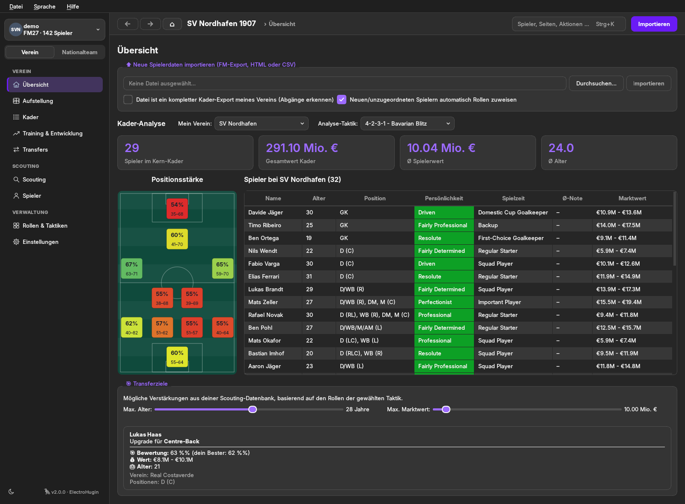
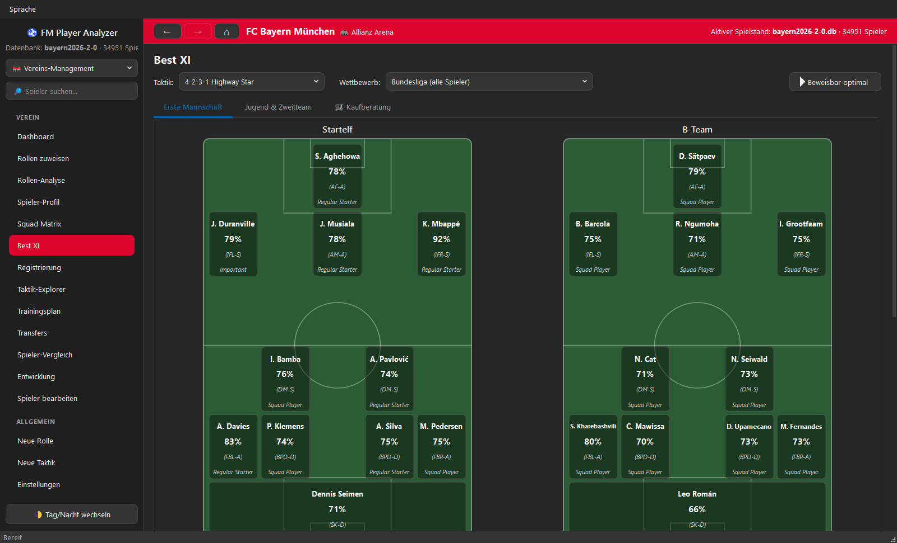
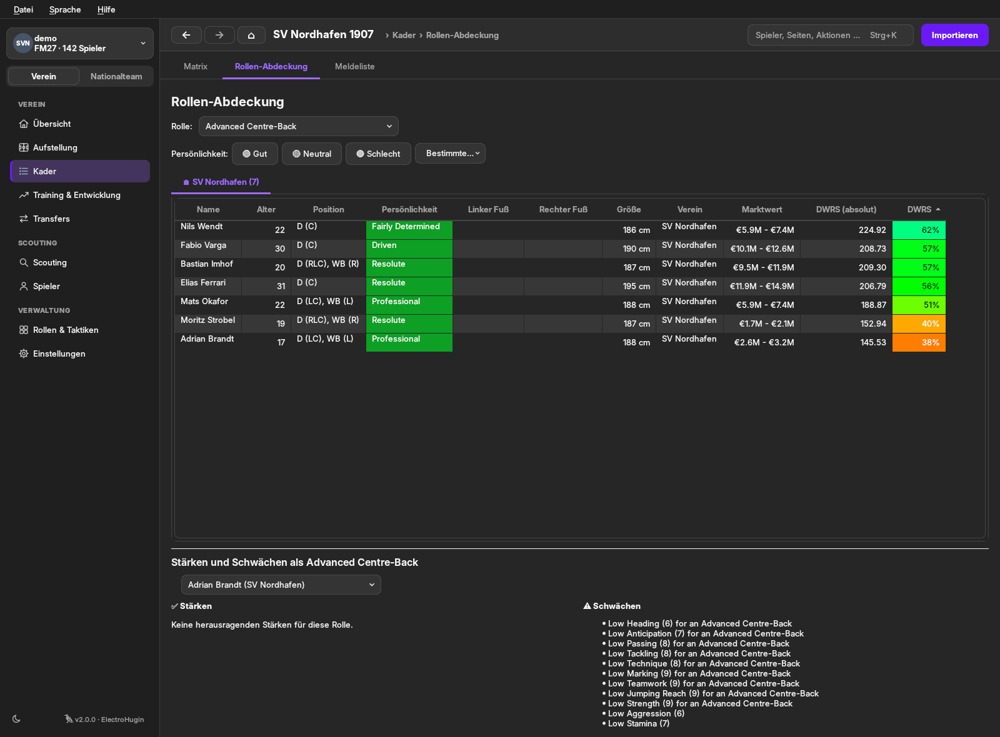
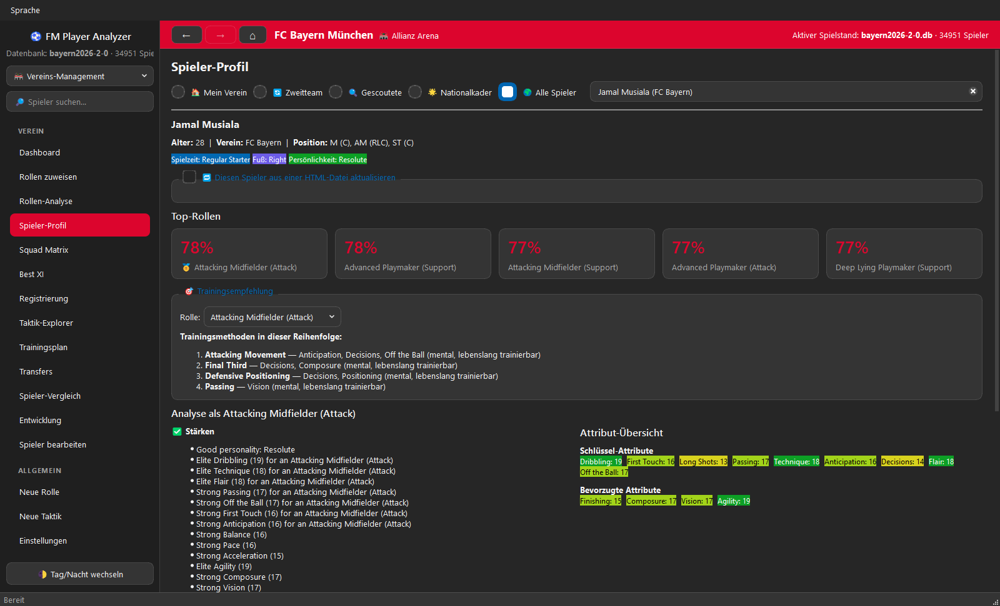
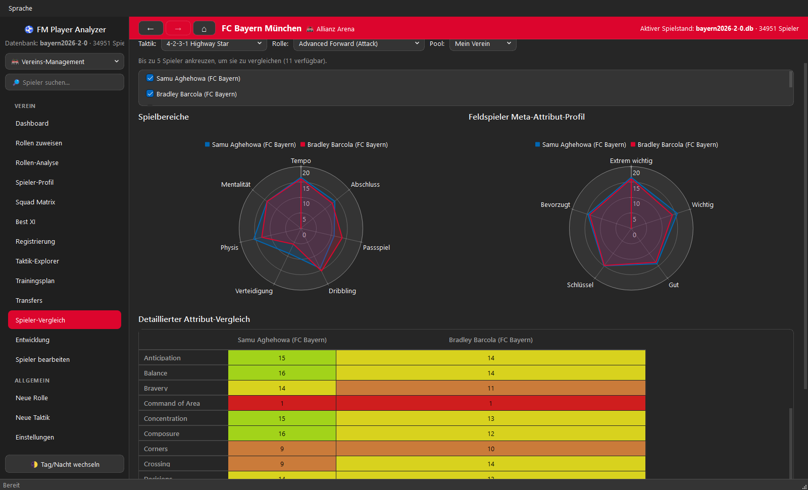
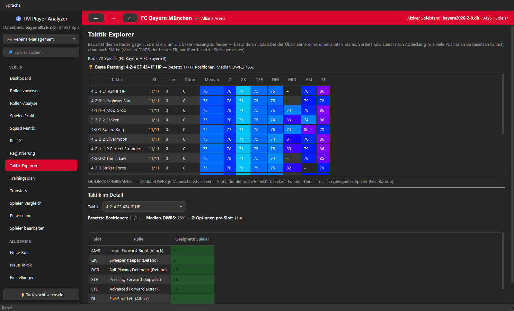
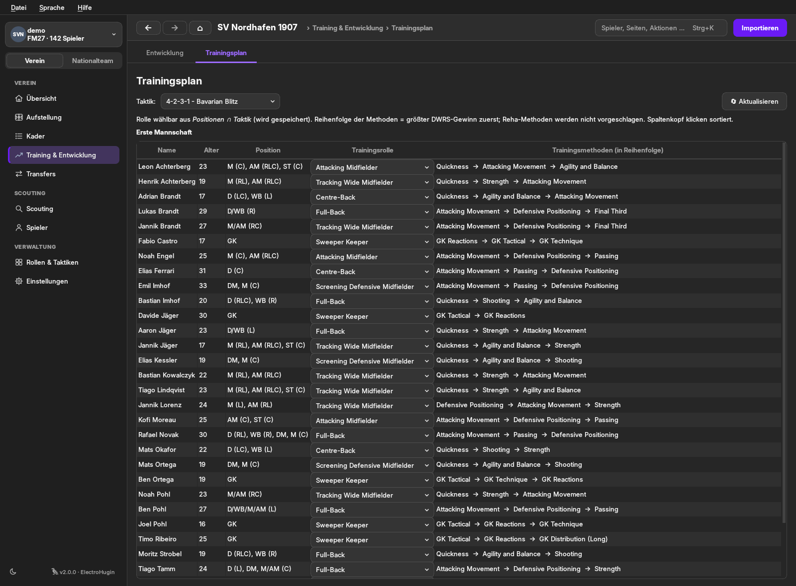
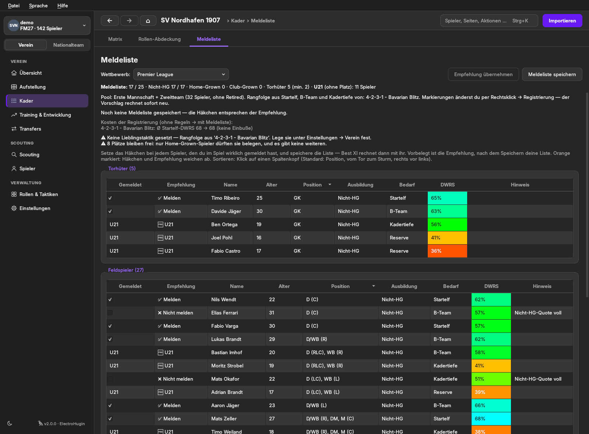
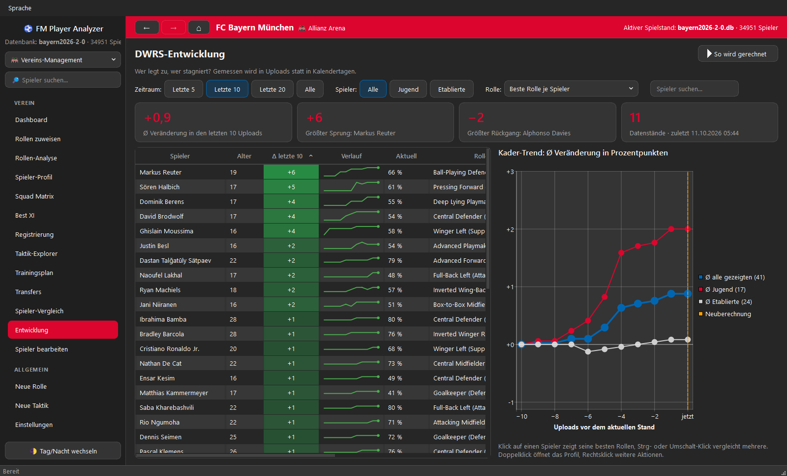
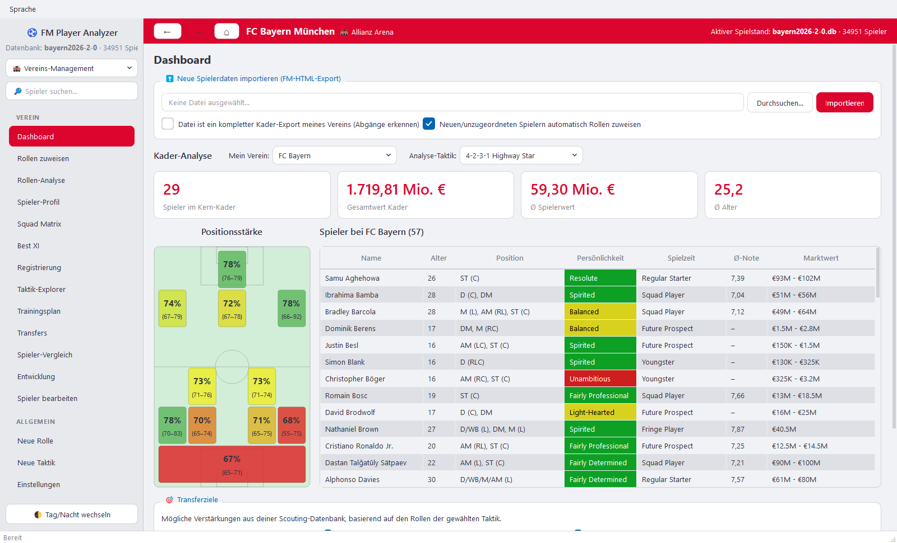

<div align="center">


### Schluss mit Raten, wer spielen soll.

Das kostenlose Desktop-Tool für den **Football Manager 2024 und 2027**, das aus deinen
Kader- und Scouting-Exporten klare Antworten macht: deine beweisbar optimale Best XI, die
versteckte Schwachstelle im Team, das Talent, das sich lohnt, und die Taktik,
für die dein Kader gebaut ist.

[](https://github.com/ElectroHugin/FM-Player-Analyzer/releases/latest)

[](https://github.com/ElectroHugin/FM-Player-Analyzer/releases/latest)
[](https://github.com/ElectroHugin/FM-Player-Analyzer/releases)
[](LICENSE)


**Du spielst FM27?** Das Spiel hat keinen eigenen Export mehr. Mit meinem
kostenlosen Begleit-Plugin **[FM View Exporter](https://github.com/ElectroHugin/FM-View-Exporter)**
wird jede Spielerliste zu einer CSV-Datei, die der Analyzer liest.

[🇬🇧 English](README.md) · **🇩🇪 Deutsch**

[Warum du es willst](#-warum-du-es-willst) ·
[Die Funktionen](#-die-funktionen) ·
[In 5 Minuten startklar](#-in-5-minuten-startklar) ·
[So funktioniert die Bewertung](#-so-funktioniert-die-bewertung-dwrs) ·
[FAQ](#-faq)



</div>

---

## 🔥 Warum du es willst

Du kennst das. 60 Spieler im Kader, 8.000 auf der Scouting-Liste, und die
Sterne im FM sagen dir, dass die Hälfte davon „3½ Sterne" hat. Wer ist
*wirklich* dein bester inverser Außenverteidiger? Verdient der 17-Jährige einen
Platz im Profikader? Hast du gerade 60 Millionen für die falsche Position
ausgegeben?

Der FM Player Analyzer beantwortet das mit **einer ehrlichen Zahl pro Spieler
und Rolle** und baut alles Weitere darauf auf.

| Du fragst | Die App antwortet |
|---|---|
| *„Wer ist mein bester Spieler für genau diese Rolle?"* | Ein Rollen-Score von 0–100 (**DWRS**) für jeden Spieler in jeder Rolle: farbcodiert, sortierbar, über Positionen hinweg vergleichbar. |
| *„Was ist meine stärkste Elf?"* | Die mathematisch optimale Best XI samt B-Team auf dem Taktik-Spielfeld, dazu Jugend und Zweitteam, je Wettbewerb. |
| *„Wo muss ich wirklich kaufen?"* | Eine Kaufberatung, die die besten Spieler deines Budgets testweise in den Kader holt und misst, wie sehr jeder die optimale Startelf verbessert — damit du den fehlenden Ball-Playing Defender kaufst statt noch eines DMs. |
| *„Welche Taktik passt zu diesem Kader?"* | Jede mitgelieferte Taktik, sortiert danach, wie gut deine Spieler sie ausfüllen. Ideal, wenn du einen neuen Verein übernimmst. |
| *„Wen soll ich holen?"* | Deine ganze Scouting-Datenbank, gerankt für die Rolle, die du brauchst, mit Filtern für Alter, Marktwert, Nationalität und Persönlichkeit. |
| *„Wird aus dem Jungen ein Star?"* | Ein Talent-Score aus aktueller Stärke, verbleibenden Entwicklungsjahren, Mentalität und Persönlichkeit. |
| *„Was soll er trainieren?"* | Die Trainingsmethoden, die seinen Rollen-Score am meisten heben, in der richtigen Reihenfolge. |
| *„Wen melde ich?"* | Ein Meldelisten-Assistent für Liga-Quoten (FM27: elf Ligen) und die Champions / Europa / Conference League. |

> 🧮 **Das Herzstück: eine beweisbar optimale Best XI.** Startelf und B-Team
> werden gemeinsam als Zuordnungsproblem mit der
> [Ungarischen Methode](https://de.wikipedia.org/wiki/Ungarische_Methode) gelöst.
> Keine andere Aufstellung deiner Spieler hat eine stärkere Startelf — und
> unter allen gleich starken bekommst du das stärkste B-Team.
> [So funktioniert's ↓](#-deine-beweisbar-optimale-best-xi--das-herzstück-der-app)

**Und sie respektiert deine Zeit und deinen Spielstand:**

- 🆓 **Kostenlos und Open Source.** Keine Werbung, kein Konto, kein Abo.
- 🔌 **Komplett offline.** Die App verbindet sich nie mit dem Internet. Deine Daten bleiben auf deinem PC.
- 🛡️ **Dein Spielstand wird nie angefasst.** Die App liest nur die HTML-Dateien, die du selbst aus dem FM exportierst.
- ⚡ **Schnell.** Eine native Windows-App für riesige Datenbanken: Ein Scouting-Export mit 11.000 Spielern ist in wenigen Sekunden importiert und bewertet, und auch mit über 80.000 Spielern bleibt alles flüssig.
- 🎯 **Kein Cheaten.** Die App sieht genau das, was du im Spiel siehst. Ungescoutete Attributbereiche wie `12–15` bleiben Bereiche.

---

## 🎬 Die Funktionen

### 🏆 Deine beweisbar optimale Best XI — das Herzstück der App

Nicht die elf höchsten Zahlen, sondern die elf, die zusammen das stärkste *Team*
ergeben. Startelf und B-Team stehen nebeneinander auf dem Spielfeld in deiner
Formation, jeder Spieler mit Bewertung, Rolle und vereinbarter Spielzeit.
Doppelklick auf einen Spieler öffnet sein Profil, Rechtsklick alles Weitere.



**Beweisbar optimal — keine Faustregel.** Die meisten Tools gehen die
Formation Position für Position durch und geben jeder ihren besten Spieler.
Das geht schief, sobald ein Spieler für zwei Positionen die beste Wahl ist: Die
Position, die zuerst dran ist, bekommt ihn, die andere den Rest. Klügere
Faustregeln helfen, aber sie raten trotzdem. Diese App rät nicht: Sie behandelt
Startelf und B-Team als ein **Zuordnungsproblem** und löst es **exakt** mit der
[Ungarischen Methode](https://de.wikipedia.org/wiki/Ungarische_Methode)
(Kuhn–Munkres), der klassischen Mathematik für die Verteilung von Arbeitern
auf Aufgaben.

**Wie eine Aufstellung dazu passt.** Die Ungarische Methode ordnet zwei Gruppen
einander eins zu eins zu, sodass der Gesamtgewinn so groß wie möglich wird.
Hier sind die beiden Gruppen deine **Spieler** (die Quellen) und die
**Positionen** von Startelf und B-Team (die Ziele), und der Gewinn, einen
Spieler auf eine Position zu stellen, ist seine **Bewertung für die Rolle
dieser Position** (DWRS, gewichtet wie von dir eingestellt). Jeder Spieler
bekommt höchstens eine Position und jede Position höchstens einen Spieler —
genau die eineindeutige Zuordnung, die das Verfahren löst.

Was du bekommst, ist garantiert, in dieser Reihenfolge:

1. **Es gibt keine stärkere Startelf.** Von allen möglichen Aufstellungen
   deiner Spieler besetzt keine mehr Positionen oder erreicht eine höhere
   Gesamtbewertung.
2. **Das beste B-Team, das diese Startelf zulässt.** Unter allen gleich starken
   Startelfs gewinnt die, die das stärkste B-Team übrig lässt — ein
   vielseitiger Innenverteidiger, der auch auf der Sechs spielen kann, beginnt
   dort, wo sein Fehlen im B-Team am wenigsten kostet.
3. **Deine Regeln gelten immer.** Berücksichtigt wird nur, wer auf einer
   Position wirklich spielen kann, bewertet mit seinem DWRS für die Rolle
   dieser Position, auf Wunsch gewichtet mit vereinbarter Spielzeit und
   natürlichen Positionen. Wen du auf eine Hauptrolle festlegst, der spielt nur
   dort.
4. **Feinschliff.** Zwei Spieler mit derselben Rolle auf gespiegelten
   Positionen, etwa zwei Innenverteidiger, tauschen die Seite, wenn sie damit
   auf ihrer bevorzugten Seite stehen.

*Ein echter Fall:* Eine schrittweise Auswahl stellte einen Verteidiger in die
Innenverteidigung, obwohl er als Sechser stärker war — das B-Team musste
dadurch einen 17-Jährigen mit 49 % im Mittelfeld aufbieten. Das exakte
Verfahren fand die Aufstellung, in der **beide** Teams stärker sind.

„Optimal" heißt optimal für die Bewertungen: Der DWRS entscheidet, wie gut ein
Spieler in einer Rolle ist, und keine Aufstellung aus diesen Bewertungen
schlägt diese. Jugend-XI und Zweitteam-XI entstehen auf dieselbe exakte Weise,
dazu die besten Tiefen-Optionen je Rolle. Wechsle oben den Wettbewerb, und
alles wird aus den Spielern neu gebaut, die dafür wirklich gemeldet sind.

<sub>Quellen: H. W. Kuhn, *The Hungarian method for the assignment problem*,
Naval Research Logistics Quarterly 2 (1955), 83–97 · J. Munkres, *Algorithms
for the Assignment and Transportation Problems*, Journal of the SIAM 5 (1957),
32–38.</sub>

### Nach Rolle scouten, nicht nach Ruf

Wähle eine Rolle und sieh deinen Kader und deine komplette Scouting-Liste dafür
gerankt, hier 8.542 gescoutete Spieler als Advanced Forward. Filtere mit einem
Klick nach Persönlichkeit und lies Stärken und Schwächen jedes Spielers *für
genau diese Rolle*.



### Alles über einen Spieler auf einer Seite

Die fünf besten Rollen, Talent-Projektion, eine persönliche Trainingsempfehlung,
Stärken und Schwächen, Schlüsselattribute und der Bewertungsverlauf. Per
Rechtsklick auf jeden Spieler irgendwo in der App öffnest du sein Profil,
vergleichst ihn, bearbeitest ihn oder setzt ihn auf Transfer-, Leih- oder
Shortlist.



### Direkter Vergleich

Bis zu fünf Spieler nebeneinander: Radar-Diagramme für Spielbereiche und für
die Attribute, die am meisten zählen, dazu eine farbcodierte Attribut-Tabelle.
Klärt die Frage „Wer spielt am Samstag?" in Sekunden.



### Finde die Taktik, für die dein Kader gebaut ist

Der Taktik-Vergleich (Aufstellung → Taktik-Vergleich) bewertet deinen Kader gegen alle Taktiken auf einmal: erst
die Abdeckung (kannst du alle elf Positionen besetzen?), dann die Stärke je
Mannschaftsteil. Ein Klick auf eine Taktik zeigt, wie viele passende Spieler du
für jeden Slot hast. Die mitgelieferten Taktiken sind aus der
[FM-Arena FM24 Hall of Fame](https://fm-arena.com/table/fm24-hall-of-fame/)
nachgebaut, eigene kannst du ergänzen. Für FM27 liegt nur eine Beispieltaktik bei
(„4-2-3-1 - Bavarian Blitz“); deine eigenen Taktiken legst du im Taktik-Editor
an, Updates lassen sie unberührt.



### Ein Trainingsplan, der rechnet

Für jeden Spieler ermittelt die App, welche Trainingsmethoden seinen
Rollen-Score am meisten heben, und berücksichtigt dabei sein Alter: Tempo
trainiert man mit 19, nicht mit 29. Eine Tabelle für die erste Mannschaft, eine
für das Zweitteam.



### Nie wieder einen Meldeplatz verschenken

An den Home-Grown-Quoten lassen gute Kader Punkte liegen. Der Assistent schlägt
eine Meldeliste vor, die regelkonform *und* voll ist: 25 Plätze,
Nicht-Home-Grown-Grenze, Club-Grown-Plätze, Mindestzahl Torhüter, U21 und
Liste B. Freie Home-Grown-Plätze füllt er mit deinen besten jungen Spielern,
statt sie leer zu lassen, und er zeigt, was die Regeln deine Startelf kosten.
Hake an, wen du wirklich gemeldet hast, speichere, und Best XI rechnet mit
dieser Liste.



### Sieh deinem Kader beim Wachsen zu

Jeder Import ist eine Momentaufnahme. Die Entwicklungsseite sortiert deinen
Kader danach, wie viel jeder Spieler in den letzten 5, 10 oder 20 Uploads
zugelegt hat, mit einer Verlaufslinie pro Spieler. Gezählt wird in Uploads
statt in Kalendertagen, denn der Export enthält kein Spieldatum. Klick auf
einen Spieler zeigt seine Rollen, Strg-Klick vergleicht mehrere. Neuberechnungen
nach geänderten Gewichten werden herausgerechnet, es zählt nur echter
Fortschritt.



### Mach es zu deinem

Dunkel- und Hellmodus, 37 Vereins-Farbschemata nach Liga sortiert, eigene
Farben und das Logo deines Vereins in der Kopfzeile.



### Und es gibt noch mehr

- **Nationalmannschafts-Modus** — eigenes Dashboard, Kader-Auswahl, Matrix und Best XI, dazu ein Nominierungs-Assistent, der sagt, wen du einladen und wen du streichen solltest.
- **Squad Matrix** — jeder Spieler gegen jede Rolle einer Taktik in einer farbcodierten Tabelle. Unter *Scouting* bietet sie Talent-, Persönlichkeits- und Attribut-Schwellen-Filter (z. B. Decisions ≥ 15 für einen AM(C)), Free-Agent-Suche und ein Δ zu deinem besten Spieler auf der gewählten Rolle; unter *Kader* zeigt sie erste Mannschaft, Zweitteam oder Jugend. CSV-Export in beiden.
- **Langzeitverletzte** — markiere einen Spieler, der monatelang ausfällt, und Best XI plant ohne ihn: Der Kader wird wieder optimal aufgestellt, und eine Tabelle zeigt Slot für Slot, wer übernimmt.
- **Gap-Analyse** — eingeklappt im Tab Kaufberatung: markiert Positionen, die gegenüber dem Team abfallen, und Spieler, die von ihrer besten Position weggezogen sind oder auf der falschen Seite spielen.
- **Transfers und Leihen** — schlägt vielversprechende Talente zum Verleihen und überzählige Spieler zum Verkauf vor.
- **Eigene Rollen und Taktiken** — eingebaute Editoren; Neues ist sofort überall verfügbar.
- **Kluger Import** — Newgens behalten über Exporte hinweg ihre Identität, Abgänge werden erkannt, und neue Spieler bekommen ihre Rollen automatisch.
- **Kleinigkeiten, die zählen** — globale Spielersuche, die „Müller" auch bei „muller" findet, Vor-/Zurück-Navigation, Oberfläche auf Englisch und Deutsch.

---

## 🚀 In 5 Minuten startklar

**1 · App installieren**

Lade die neueste `FMPlayerAnalyzer-…-Windows-x64-Setup.exe` von der
[Releases-Seite](https://github.com/ElectroHugin/FM-Player-Analyzer/releases/latest)
und führe sie aus. Mehr brauchst du nicht. Der Installer ist nicht signiert,
deshalb zeigt Windows eventuell einen SmartScreen-Hinweis: *Weitere
Informationen → Trotzdem ausführen*.

> **Football Manager 2027:** FM27 hat keinen eigenen Export mehr. Installiere das
> kostenlose Plugin [FM View Exporter](https://github.com/ElectroHugin/FM-View-Exporter),
> lege im Spiel dessen Ansicht *Analyzer* an und drücke in einer Spielerliste **F9**.
> Die CSV-Datei importierst du in einen Spielstand mit der Version *Football
> Manager 2027* (Standard für neue Spielstände). Spaltenzuordnung und Details:
> [docs/IMPORT-FM27.md](docs/IMPORT-FM27.md). Der Installer kann fertige FM27-Ansichten
> (Kader, Spielerdatenbank, Shortlist) gleich in deinen FM27-Ordner `views` legen;
> später geht das über *Einstellungen → Verein → Ansichten für FM27 installieren*.
> Schritt 2 und 3 unten gelten für FM24.

**2 · Export-Ansicht in den FM holen**

Die App liest den normalen HTML-Export des Football Manager (CSV-Exporte
gehen auch). Am einfachsten
geht es mit den fertigen Ansichten von **PlayingSquirrel**
([@playingsquirrel](https://x.com/playingsquirrel)):
[hier die FM24-Ansichtsdateien herunterladen](https://www.mediafire.com/file/ymf6xhw0bk4enjj/FM24_files.zip/file)
und im FM importieren. Achte darauf, dass die Ansicht die Spalte **UID**
enthält.

**3 · Spieler exportieren**

Öffne im FM deinen Kader (und später jede Scouting- oder Spielersuch-Liste) mit
dieser Ansicht, dann *Rechtsklick → Drucken/Exportieren → Webseite (.html)*.

**4 · Importieren**

Öffne den FM Player Analyzer, geh auf **Dashboard → Neue Spielerdaten
importieren**, wähle die Datei und klicke auf **Importieren**. Rollen werden
zugewiesen und alle Bewertungen automatisch berechnet.

**5 · Der App sagen, wer du bist**

Wähle auf dem Dashboard **Mein Verein**. Unter **Einstellungen → Verein**
kannst du ein Zweitteam, deine Lieblings-Taktiken und, falls deine Liga eine
Meldeliste verlangt, die Registrierungsregeln eintragen.

**6 · Loslegen**

Fang mit **Aufstellung** (Best XI) an, schau dann in **Transfers → Kaufberatung**
und **Aufstellung → Taktik-Vergleich**. Importiere einen großen Scouting-Export und
öffne **Scouting → Nach Rolle**, um zu sehen, wen du wirklich kaufen solltest.

> **Tipps**
> - Importiere neu, so oft du willst; einmal pro Spielmonat ist ein guter Rhythmus. Die App aktualisiert bekannte Spieler und baut ihren Bewertungsverlauf auf.
> - Wenn du deinen kompletten Kader importierst, hake *„Datei ist ein kompletter Kader-Export meines Vereins"* an. Die App fragt dann, was aus den fehlenden Spielern geworden ist.
> - Aktiviere für Newgens im FM die Option *„UIDs verwenden"*, damit Spieler über Exporte hinweg eine feste ID behalten.
> - Die Oberfläche ist standardmäßig englisch; Deutsch gibt es im Menü **Language**.

---

## 🧠 So funktioniert die Bewertung (DWRS)

**DWRS**, der *Dynamic Weighted Role Score*, ist eine Zahl von 0 bis 100, die
sagt, wie gut ein Spieler zu einer bestimmten Rolle passt. Keine Blackbox: Jedes
Gewicht ist sichtbar und einstellbar.

1. **Nicht alle Attribute sind gleich wichtig.** Angelehnt an Community-Recherche
   (vor allem
   [u/florin133s Meta-Attribut-Guide](https://www.reddit.com/r/footballmanagergames/comments/16fuksi/a_not_so_short_guide_to_meta_player_attributes/))
   sind die Attribute in Wichtigkeits-Stufen eingeteilt. Pace und Acceleration
   wiegen weit mehr als Teamwork.
2. **Die Rolle bestimmt, was zählt.** Attribute, die für die Rolle *Schlüssel*
   sind, zählen ×1,5, *bevorzugte* ×1,2. Passing und Vision sind bei einem
   Ball-Playing Defender wichtiger, Crossing und Dribbling bei einem Winger.
3. **Normalisiert auf 0–100 %.** 0 % ist ein Spieler mit überall 1, 100 % einer
   mit 20 in allem, was für die Rolle zählt. So sind Scores über Rollen und
   Positionen hinweg vergleichbar.

<details>
<summary><b>Die vollständige Formel und die Standardgewichte</b></summary>

<br>

| Stufe | Standardgewicht | Beispiele |
|---|---|---|
| Extremely Important | 8,0 | Pace, Acceleration |
| Important | 4,0 | Jumping Reach, Anticipation, Balance, Agility, Concentration, Finishing |
| Good | 2,0 | Work Rate, Dribbling, Stamina, Strength, Passing, Determination, Vision |
| Decent | 1,0 | Long Shots, Marking, Decisions, First Touch |
| Almost Irrelevant | 0,2 | Off the Ball, Tackling, Teamwork, Composure, Technique, Positioning |

Für die bewertete Rolle wird jedes Attribut mit seinem Rollenfaktor
multipliziert (Schlüssel ×1,5, bevorzugt ×1,2, sonst ×1). Innerhalb jeder Stufe
mittelt die App diese Werte und multipliziert mit dem Stufengewicht; die Summe
über alle Stufen ist der „absolute" Score. Er wird dann zwischen derselben
Rechnung für einen Spieler mit 1 in jedem Attribut (0 %) und einen mit 20 in
jedem Attribut (100 %) skaliert.

Torhüter haben eigene Stufen und Gewichte. Abgeleitet sind sie aus den
Saisonstatistiken von 335 Torhütern: Gemessen wurde, welche Attribute mit
mehr verhinderten Toren gegenüber der Erwartung (xGP/90) einhergehen, auch bei
gleichem Gesamtniveau. Diese Gewichtung sagt die Torwartleistung deutlich
besser voraus als die frühere (Korrelation 0,58 statt 0,43).

| Stufe | Standardgewicht | Attribute |
|---|---|---|
| Top Importance | 3,0 | Positioning, Aerial Reach, Handling |
| High Importance | 2,0 | Agility, Anticipation, Kicking |
| Medium Importance | 1,0 | Reflexes, Command of Area, Concentration, Throwing |
| Key | 0,5 | weitere Schlüssel-Attribute der Rolle (z. B. Composure beim Sweeper Keeper) |
| Preferable | 0,25 | weitere bevorzugte Attribute der Rolle (z. B. Passing, Vision) |
| Other | 0,2 | Bravery, One vs One, Rushing Out |

Die Stufengewichte, die Multiplikatoren und die Schlüssel- bzw. bevorzugten
Attribute jeder Rolle lassen sich unter **Einstellungen** ändern. Passe sie an
deine Spielidee an und starte dort unter **DWRS-Gewichte** die Neuberechnung.

</details>

---

## ❓ FAQ

**Ist das wirklich kostenlos?**
Ja. Open Source unter GPLv3, keine Werbung, keine Bezahlversion.

**Kann die App meinen Spielstand beschädigen?**
Nein. Die App öffnet deinen Spielstand nie. Sie liest die HTML-Dateien, die du
aus dem Spiel exportierst, und führt ihre eigene Datenbank unter
`%LOCALAPPDATA%\FM24PlayerAnalyzer`. Updates und Deinstallation lassen diesen
Ordner unangetastet.

**Ist das Cheaten?**
Die App nutzt nur, was dir das Spiel zeigt. Attribute von nicht vollständig
gescouteten Spielern bleiben verdeckte Bereiche, genau wie exportiert.

**Welche Football-Manager-Versionen werden unterstützt?**
Football Manager 2024 und Football Manager 2027 (seit Version 2.0.0; Import über
den [FM View Exporter](https://github.com/ElectroHugin/FM-View-Exporter)). Das
Import-Format ist pro Spielversion definiert, weitere Versionen lassen sich also ergänzen.

**Mac oder Linux?**
Windows 10 / 11 (64-bit), dazu ein Linux-AppImage auf der Release-Seite. Kein macOS.

**Meine Liga steht nicht bei den Registrierungsregeln.**
Wähle *Standard (keine Beschränkung)*. Für FM24 ist die Premier League
hinterlegt, für FM27 elf Ligen (Bundesliga, Premier League, LaLiga, Serie A,
Ligue 1, Liga Portugal, Super League Schweiz, Bundesliga Österreich, Russian
Premier Liga, Ukrainian Premier League, Süper Lig, Details in
[docs/REGISTRIERUNG-FM27.md](docs/REGISTRIERUNG-FM27.md)). Die UEFA-Liste
funktioniert mit jeder Liga. Geprüft werden Kadergröße sowie im Land und im
Verein ausgebildete Spieler, nicht aber Grenzen für Ausländer oder
Nicht-EU-Spieler.

**Du möchtest eine weitere Liga?** Alle Ligen kann ich nicht selbst erfassen.
Bitte [öffne ein Issue](https://github.com/ElectroHugin/FM-Player-Analyzer/issues/new)
mit dem Namen und dem Land der Liga und einem Screenshot ihrer *Squad Selection
Rules* aus dem FM.

**Ich habe die ältere Streamlit-Version benutzt.**
Ein einmaliger Migrations-Assistent (Einstellungen → Datenbank →
*Legacy-Datenbank importieren*) übernimmt deine alten Datenbanken und
Einstellungen.

---

<details>
<summary><b>📋 Export-Spalten, die die App versteht (Football Manager 2024)</b></summary>

<br>

Zwingend sind nur **UID** und **Name**. Jede weitere Spalte verbessert die
Bewertungen; ein fehlendes Attribut gilt einfach als unbekannt.

- **Identität & Info:** `UID`, `Name`, `Age`, `Nat`, `2nd Nat`, `Club`,
  `Position`, `Personality`, `Media Handling`, `Preferred Foot`, `Left Foot`,
  `Right Foot`, `Height`, `Wage`, `Transfer Value`, `Av Rat`,
  `Agreed Playing Time`
- **Technisch:** `Cor`, `Cro`, `Dri`, `Fin`, `Fir`, `Hea`, `Lon`, `Mar`,
  `Pas`, `Tck`, `Tec`
- **Mental:** `Agg`, `Ant`, `Bra`, `Cmp`, `Cnt`, `Dec`, `Det`, `Fla`, `Ldr`,
  `OtB`, `Pos`, `Tea`, `Vis`, `Wor`
- **Physisch:** `Acc`, `Agi`, `Bal`, `Jum`, `Pac`, `Sta`, `Str`
- **Torwart:** `1v1`, `Aer`, `Cmd`, `Han`, `Kic`, `Ref`, `TRO`, `Thr`

Die Zuordnung steht in
[`desktop/src/core/Constants.cpp`](desktop/src/core/Constants.cpp)
(`fm24AttributeMapping`).

</details>

<details>
<summary><b>🛠️ Für Entwickler: Repository-Aufbau und Bauen aus dem Quellcode</b></summary>

<br>

| Verzeichnis | Implementierung | Status |
|---|---|---|
| [`desktop/`](desktop/) | **C++ 20 / Qt 6 Widgets** — die native Windows-App | Aktiv |
| [`legacy/`](legacy/) | **Python / Streamlit** — die ursprüngliche Web-Version | Als Verhaltens-Referenz erhalten |

Voraussetzungen: Visual Studio 2022 (C++, x64), CMake ≥ 3.28, Ninja und
Qt 6.8 LTS mit dem Qt-Charts-Add-on.

```powershell
cd desktop
.\scripts\build.ps1 -Preset msvc-release -Test   # bauen + Tests ausführen
.\scripts\package.ps1                             # windeployqt + Installer
```

Details in [`desktop/README.md`](desktop/README.md). Ideen und technischer
Backlog stehen in [`desktop/IDEEN.md`](desktop/IDEEN.md) und
[`desktop/BACKLOG.md`](desktop/BACKLOG.md).

</details>

---

## 🙏 Auf den Schultern der FM-Community

- Die Meta-Attribut-Gewichtung wurde von der Recherche von
  **[u/florin133](https://www.reddit.com/r/footballmanagergames/comments/16fuksi/a_not_so_short_guide_to_meta_player_attributes/)**
  inspiriert.
- Die Export-Ansichten stammen von
  **[PlayingSquirrel](https://x.com/playingsquirrel)**.
- Die mitgelieferten Taktiken sind aus der
  **[FM-Arena FM24 Hall of Fame](https://fm-arena.com/table/fm24-hall-of-fame/)**
  nachgebaut. Voller Dank an ihre Autoren und das FM-Arena-Team.
- Frühe Ideen für die Datenansichten kamen von der
  **[FM Client App](https://fm-client-app.vercel.app/)**.

Fehler gefunden oder eine Idee?
[Öffne ein Issue](https://github.com/ElectroHugin/FM-Player-Analyzer/issues).
Und wenn die App deinem Spielstand hilft: Ein ⭐ auf GitHub hilft anderen, sie
zu finden.

## Lizenz & Haftungsausschluss

Lizenziert unter **GPLv3**, siehe [LICENSE](LICENSE).

Dies ist ein inoffizielles, von Fans erstelltes Tool und wird von Sports
Interactive oder SEGA weder unterstützt noch ist es mit ihnen verbunden.
*Football Manager*, das Football-Manager-Logo und Sports Interactive sind
Marken von Sports Interactive Limited; SEGA und das SEGA-Logo sind Marken der
SEGA Corporation. Alle spielinternen Daten sind Eigentum von Sports Interactive
und/oder SEGA. Die Screenshots zeigen einen fiktiven Spielstand. Die Software
wird „wie besehen" bereitgestellt, ohne Gewährleistung jeglicher Art.
