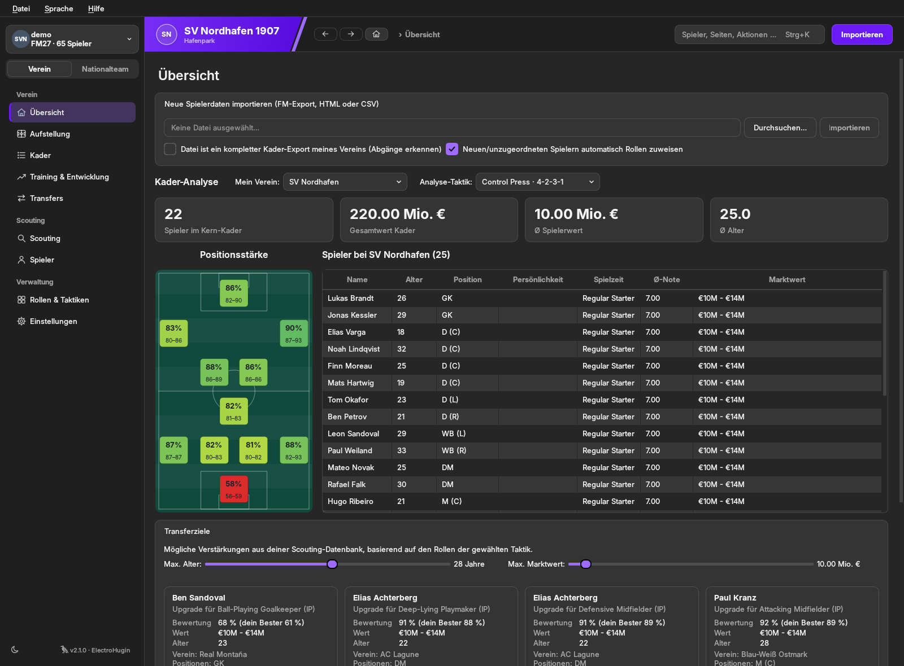
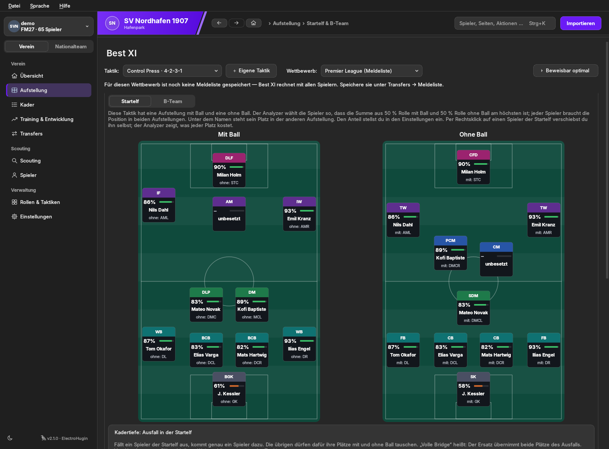
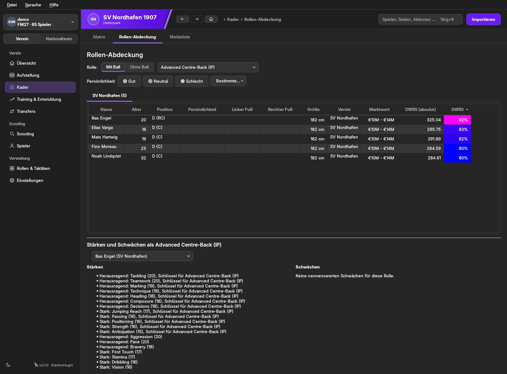
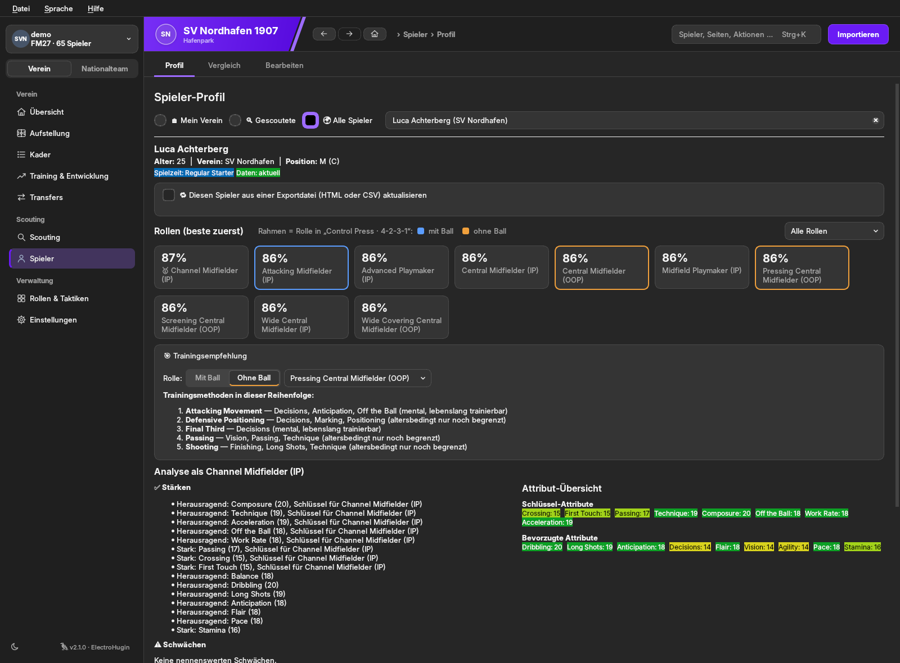
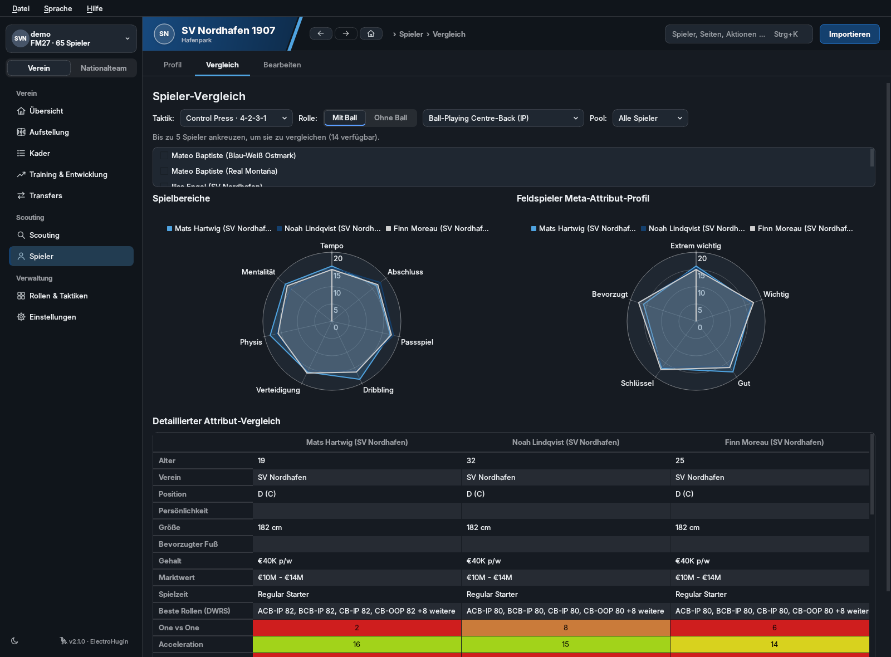
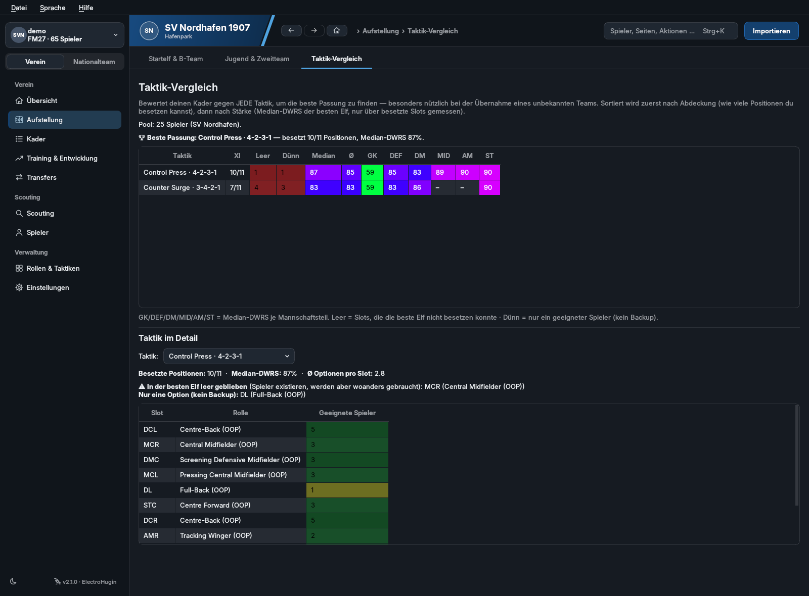
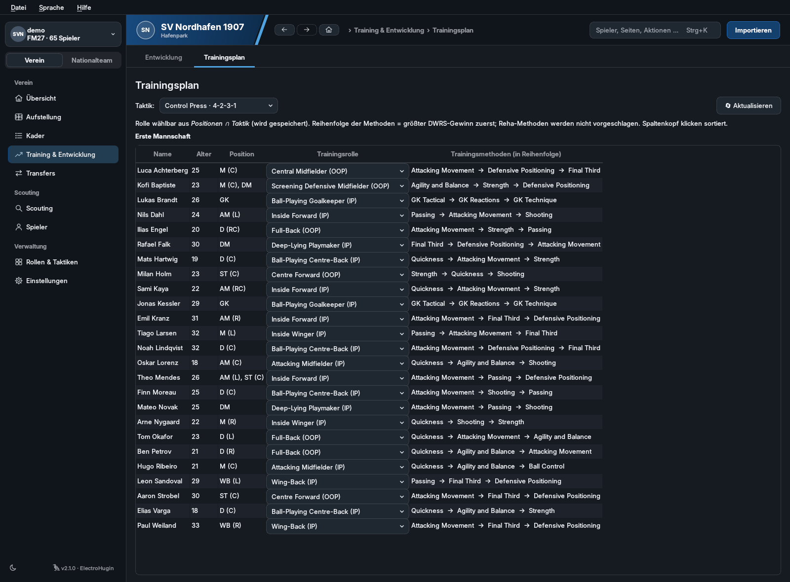
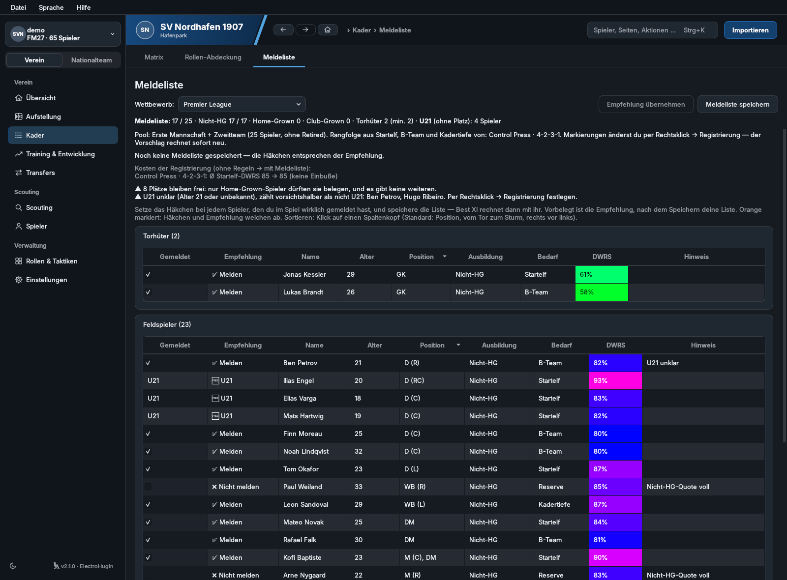
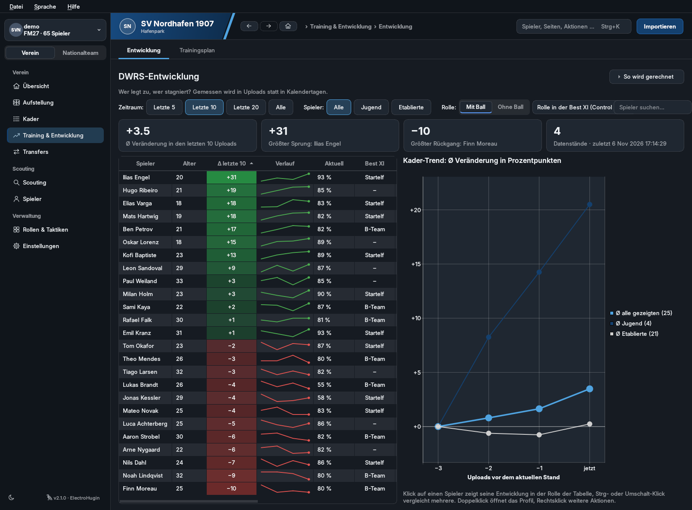
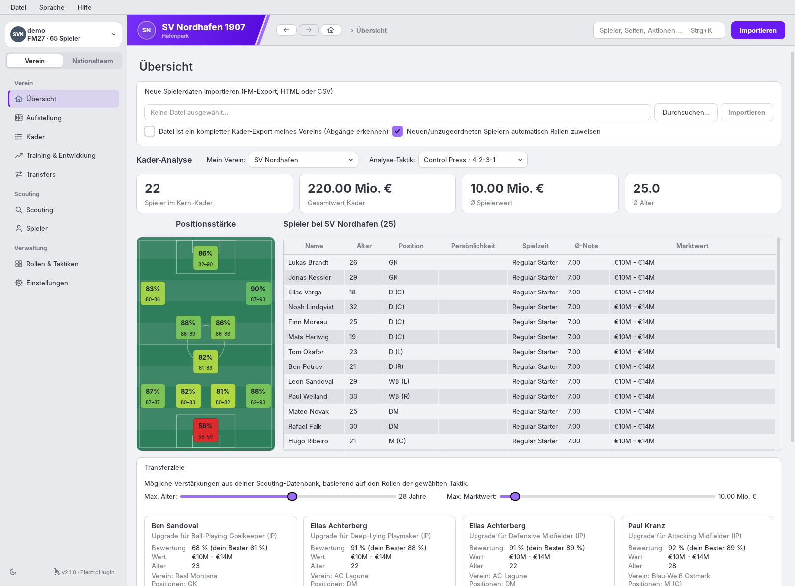

<div align="center">


### Schluss mit Raten, wer spielen soll.

Das kostenlose Desktop-Tool für den **Football Manager 2024 und 2027**, das aus deinen
Kader- und Scouting-Exporten klare Antworten macht: deine beweisbar optimale Best XI, die
versteckte Schwachstelle im Team, das Talent, das sich lohnt, und die Taktik,
für die dein Kader gebaut ist.

[](https://github.com/ElectroHugin/FM-Player-Analyzer/releases/latest)

[](https://github.com/ElectroHugin/FM-Player-Analyzer/releases/latest)
[](https://github.com/ElectroHugin/FM-Player-Analyzer/releases)
[](LICENSE)


**Du spielst FM27?** Wähle einfach deine Spielstanddatei: Der Analyzer liest sie
direkt (nur lesend) und holt sich nach jedem Speichern im Spiel die neuen Daten.
Alternativ macht das kostenlose Plugin
**[FM View Exporter](https://github.com/ElectroHugin/FM-View-Exporter)** jede
Spielerliste zu einer CSV-Datei.

[🇬🇧 English](README.md) · **🇩🇪 Deutsch**

[Warum du es willst](#-warum-du-es-willst) ·
[Die Funktionen](#-die-funktionen) ·
[In 5 Minuten startklar](#-in-5-minuten-startklar) ·
[So funktioniert die Bewertung](#-so-funktioniert-die-bewertung-dwrs) ·
[FAQ](#-faq)



</div>

---

## 🔥 Warum du es willst

Du kennst das. 60 Spieler im Kader, 8.000 auf der Scouting-Liste, und die
Sterne im FM sagen dir, dass die Hälfte davon „3½ Sterne" hat. Wer ist
*wirklich* dein bester inverser Außenverteidiger? Verdient der 17-Jährige einen
Platz im Profikader? Hast du gerade 60 Millionen für die falsche Position
ausgegeben?

Der FM Player Analyzer beantwortet das mit **einer ehrlichen Zahl pro Spieler
und Rolle** und baut alles Weitere darauf auf.

| Du fragst | Die App antwortet |
|---|---|
| *„Wer ist mein bester Spieler für genau diese Rolle?"* | Ein Rollen-Score von 0–100 (**DWRS**) für jeden Spieler in jeder Rolle: farbcodiert, sortierbar, über Positionen hinweg vergleichbar. |
| *„Was ist meine stärkste Elf?"* | Die mathematisch optimale Best XI auf dem Taktik-Spielfeld, für FM27 mit Ball und ohne Ball, dazu B-Team, Jugend, Zweitteam und die Kadertiefe für jeden Ausfall. |
| *„Wo muss ich wirklich kaufen?"* | Eine Kaufberatung, die die besten Spieler deines Budgets testweise in den Kader holt und misst, wie sehr jeder die optimale Startelf verbessert — damit du den fehlenden Ball-Playing Defender kaufst statt noch eines DMs. |
| *„Welche Taktik passt zu diesem Kader?"* | Jede mitgelieferte Taktik, sortiert danach, wie gut deine Spieler sie ausfüllen. Ideal, wenn du einen neuen Verein übernimmst. |
| *„Wen soll ich holen?"* | Deine ganze Scouting-Datenbank, gerankt für die Rolle, die du brauchst, mit Filtern für Alter, Marktwert, Nationalität und Persönlichkeit. |
| *„Wird aus dem Jungen ein Star?"* | Ein Talent-Score aus aktueller Stärke, verbleibenden Entwicklungsjahren, Mentalität und Persönlichkeit. |
| *„Was soll er trainieren?"* | Die Trainingsmethoden, die seinen Rollen-Score am meisten heben, in der richtigen Reihenfolge. |
| *„Wen melde ich?"* | Ein Meldelisten-Assistent für Liga-Quoten (FM27: elf Ligen) und die Champions / Europa / Conference League. |

> 🧮 **Das Herzstück: eine beweisbar optimale Best XI.** Die App rät nicht,
> sie rechnet exakt: Keine andere Aufstellung deiner Spieler hat eine stärkere
> Startelf, und unter allen gleich starken bekommst du das stärkste B-Team.
> [So funktioniert's ↓](#-deine-beweisbar-optimale-best-xi--das-herzstück-der-app)
> [So funktioniert's ↓](#-deine-beweisbar-optimale-best-xi--das-herzstück-der-app)

**Und sie respektiert deine Zeit und deinen Spielstand:**

- 🆓 **Kostenlos und Open Source.** Keine Werbung, kein Konto, kein Abo.
- 🔌 **Komplett offline.** Die App verbindet sich nie mit dem Internet. Deine Daten bleiben auf deinem PC.
- 🛡️ **Dein Spielstand bleibt unberührt.** Die App liest Exporte oder deine FM27-Spielstanddatei, schreibt aber nie hinein.
- ⚡ **Schnell.** Eine native Windows-App für riesige Datenbanken: Ein Scouting-Export mit 11.000 Spielern ist in wenigen Sekunden importiert und bewertet, und auch mit über 80.000 Spielern bleibt alles flüssig.
- 🎯 **Kein Cheaten.** Die App zeigt, was du im Spiel siehst. Nicht voll gescoutete Attribute bleiben Bereiche wie `12–15`, auch beim Lesen des FM27-Spielstands.

---

## 🎬 Die Funktionen

### 🏆 Deine beweisbar optimale Best XI — das Herzstück der App

Nicht die elf höchsten Zahlen, sondern die elf, die zusammen das stärkste *Team*
ergeben. Startelf und B-Team stehen nebeneinander auf dem Spielfeld in deiner
Formation, jeder Spieler mit Bewertung, Rolle und vereinbarter Spielzeit.
Doppelklick auf einen Spieler öffnet sein Profil, Rechtsklick alles Weitere.



**Beweisbar optimal, keine Faustregel.** Die meisten Tools gehen die Formation
Position für Position durch und geben jeder ihren besten Spieler. Das geht
schief, sobald ein Spieler für zwei Positionen die beste Wahl ist. Diese App
rechnet die ganze Aufstellung auf einmal aus und garantiert:

1. **Es gibt keine stärkere Startelf** aus deinen Spielern.
2. **Das beste B-Team, das diese Startelf zulässt.** Ein vielseitiger
   Innenverteidiger, der auch auf der Sechs spielen kann, beginnt dort, wo sein
   Fehlen im B-Team am wenigsten kostet.
3. **Deine Regeln gelten immer:** nur Spieler, die die Position wirklich
   spielen können, auf Wunsch gewichtet mit Spielzeit und natürlichen
   Positionen. Wen du festlegst, der spielt dort.

**FM27: zwei Aufstellungen, dieselben elf.** In FM27 hat jede Taktik eine
Aufstellung mit Ball und eine ohne Ball. Der Analyzer sucht die elf Spieler, die
in beiden zusammen am stärksten sind. Wie stark der Ballbesitz zählt, stellst du
selbst ein. Fällt ein Spieler aus, zeigt die **Kadertiefe**, wer übernimmt und
wie die übrigen dafür ihre Plätze tauschen. Fehlt dir ein passender Ersatz, startet
ein Rechtsklick auf den Platz die **Bridge-Suche** im Scouting: Sie findet
Spieler, die beide Rollen dieses Platzes können.

Jugend-XI und Zweitteam-XI entstehen auf dieselbe Weise. Wechsle oben den
Wettbewerb, und alles wird aus den Spielern neu gebaut, die dafür gemeldet sind.

<details>
<summary><b>Wie das mathematisch funktioniert</b></summary>

<br>

Startelf und B-Team sind ein **Zuordnungsproblem**: Spieler auf der einen
Seite, Positionen auf der anderen, und der Gewinn für „Spieler X auf Position
Y“ ist seine Bewertung für die Rolle dieser Position (DWRS). Jeder Spieler
bekommt höchstens eine Position, jede Position höchstens einen Spieler. Für
FM24 löst der Analyzer das exakt mit der
[Ungarischen Methode](https://de.wikipedia.org/wiki/Ungarische_Methode)
(Kuhn–Munkres). Für die zwei Aufstellungen in FM27 wird daraus ein
kostenminimaler Fluss: Jeder Spieler bekommt einen Platz mit Ball und einen ohne
Ball, und sein Wert ist der gewichtete Mittelwert beider Rollen.

Zum Feinschliff können gleichwertige Spieler auf gespiegelten zentralen
Positionen auf ihre manuell bevorzugte Seite wechseln, auch bei unterschiedlichen
Rollen. Der bevorzugte Fuß entscheidet darüber nicht. In FM27 werden die
ausgewählten elf Spieler in beiden Phasen zunächst nach manuellen Seitenwünschen,
dann nach möglichst kurzen Gesamtwegen angeordnet. Der einstellbare Spielraum
beträgt standardmäßig **0,1 DWRS-Punkte für die gesamte Mannschaft** gegenüber
der ursprünglichen Zuordnung, sowohl ungewichtet als auch gewichtet. Bei null
sind nur Gleichstände erlaubt. Fest gesetzte Positionen und die ausgewählten
Spieler bleiben erhalten. Die angezeigte Zuordnung kann deshalb einen kleinen
Bewertungsvorteil zugunsten kürzerer Wege aufgeben.

*Ein echter Fall:* Eine schrittweise Auswahl stellte einen Verteidiger in die
Innenverteidigung, obwohl er als Sechser stärker war. Das B-Team musste dadurch
einen 17-Jährigen mit 49 % im Mittelfeld aufbieten. Das exakte Verfahren fand
die Aufstellung, in der **beide** Teams stärker sind.

<sub>Quellen: H. W. Kuhn, *The Hungarian method for the assignment problem*,
Naval Research Logistics Quarterly 2 (1955), 83–97 · J. Munkres, *Algorithms
for the Assignment and Transportation Problems*, Journal of the SIAM 5 (1957),
32–38.</sub>

</details>

### Dein FM27-Spielstand, direkt und live

Kein Export, kein Scrollen durch Listen: Wähle die `.fm`-Datei deiner Karriere,
und der Analyzer liest deinen Kader und alle Spieler, die dein Scouting kennt.
Schalte unter *Einstellungen → Verein* **Spielstand live verfolgen** ein, dann
liest er nach jedem Speichern im Spiel die neueste Datei von selbst ein. Die
**Attribut-Maskierung wie im Spiel** (Standard an) sorgt dafür, dass du nur
siehst, was dein Scouting weiß. Details stehen in
[docs/IMPORT-FM27.md](docs/IMPORT-FM27.md).

### Nach Rolle scouten, nicht nach Ruf

Wähle eine Rolle und sieh deinen Kader und deine komplette Scouting-Liste dafür
gerankt. Filtere nach Alter, Marktwert und Persönlichkeit und lies Stärken und
Schwächen jedes Spielers *für genau diese Rolle*. In FM27 schaltest du die
Rollenlisten zwischen **Mit Ball** und **Ohne Ball** um, und welche Spalten die
Scouting-Tabelle zeigt, bestimmst du selbst.



### Alles über einen Spieler auf einer Seite

Alle Rollen nach Bewertung (die Rollen deiner Taktik farbig umrandet),
Talent-Projektion, Trainingsempfehlung für deine eigenen Spieler, Stärken und
Schwächen und der Bewertungsverlauf. Per Rechtsklick auf jeden Spieler irgendwo
in der App öffnest du sein Profil, vergleichst ihn, bearbeitest ihn oder setzt
ihn auf Transfer-, Leih- oder Shortlist.



### Direkter Vergleich

Bis zu fünf Spieler nebeneinander: Radar-Diagramme für Spielbereiche und für
die Attribute, die am meisten zählen, dazu eine farbcodierte Attribut-Tabelle.
Klärt die Frage „Wer spielt am Samstag?" in Sekunden.



### Finde die Taktik, für die dein Kader gebaut ist

Der Taktik-Vergleich (Aufstellung → Taktik-Vergleich) bewertet deinen Kader gegen alle Taktiken auf einmal: erst
die Abdeckung (kannst du alle elf Positionen besetzen?), dann die Stärke je
Mannschaftsteil. Ein Klick auf eine Taktik zeigt, wie viele passende Spieler du
für jeden Slot hast. Die mitgelieferten Taktiken sind aus der
[FM-Arena FM24 Hall of Fame](https://fm-arena.com/table/fm24-hall-of-fame/)
nachgebaut. Für FM27 liegen zwei Beispieltaktiken bei („Control Press · 4-2-3-1“
und „Counter Surge · 3-4-2-1“), auch als Spieldateien für FM27. Deine eigenen
Taktiken baust du im Taktik-Editor und teilst sie als Datei mit anderen.



### Ein Trainingsplan, der rechnet

Für jeden Spieler ermittelt die App, welche Trainingsmethoden seinen
Rollen-Score am meisten heben, und berücksichtigt dabei sein Alter: Tempo
trainiert man mit 19, nicht mit 29. Eine Tabelle für die erste Mannschaft, eine
für das Zweitteam.



### Nie wieder einen Meldeplatz verschenken

An den Home-Grown-Quoten lassen gute Kader Punkte liegen. Der Assistent schlägt
eine Meldeliste vor, die regelkonform *und* voll ist: 25 Plätze,
Nicht-Home-Grown-Grenze, Club-Grown-Plätze, Mindestzahl Torhüter, U21 und
Liste B. Freie Home-Grown-Plätze füllt er mit deinen besten jungen Spielern,
statt sie leer zu lassen, und er zeigt, was die Regeln deine Startelf kosten.
Bei LaLiga, die ein Gehaltsbudget und ein Mindestgehalt vorgibt, trägst
du beides direkt auf der Meldeliste ein, und der Vorschlag hält sich daran.
Hake an, wen du wirklich gemeldet hast, speichere, und Best XI rechnet mit
dieser Liste.



### Sieh deinem Kader beim Wachsen zu

Jeder Import ist eine Momentaufnahme. Die Entwicklungsseite sortiert deinen
Kader danach, wie viel jeder Spieler in den letzten 5, 10 oder 20 Uploads
zugelegt hat, mit einer Verlaufslinie pro Spieler. Gezählt wird in Uploads
statt in Kalendertagen; liest du einen FM27-Spielstand ein, steht an jedem
Datenstand das Ingame-Datum. Seit 2.2.0 legt der Analyzer dabei pro Ingame-Monat
einen Verlauf für deinen Kader, die Shortlist und gescoutete Spieler an:
Attribute, Ø-Note, Marktwert und Gehalt, nur wenn sich etwas geändert hat. Im
Spielerprofil siehst du ihn als Tabelle; ältere Saisons werden auf ihren Stand
am Saisonende verdichtet (Saisonbeginn einstellbar). Klick auf
einen Spieler zeigt seine Rollen, Strg-Klick vergleicht mehrere. Neuberechnungen
nach geänderten Gewichten werden herausgerechnet, es zählt nur echter
Fortschritt.



### Mach es zu deinem

Dunkel- und Hellmodus, Farbvorlagen nach Liga sortiert, eigene Farben und dein
Vereinslogo in der Kopfzeile. Hast du für FM einen Graphics-Ordner mit Wappen und
Porträts, kann der Analyzer ihn mitnutzen (optional, standardmäßig aus).



### Und es gibt noch mehr

- **Nationalmannschafts-Modus** — eigenes Dashboard, Kader-Auswahl, Matrix und Best XI, dazu ein Nominierungs-Assistent, der sagt, wen du einladen und wen du streichen solltest.
- **Squad Matrix** — jeder Spieler gegen jede Rolle einer Taktik in einer farbcodierten Tabelle. Unter *Scouting* bietet sie Talent-, Persönlichkeits- und Attribut-Schwellen-Filter (z. B. Decisions ≥ 15 für einen AM(C)), Free-Agent-Suche und ein Δ zu deinem besten Spieler auf der gewählten Rolle; unter *Kader* zeigt sie erste Mannschaft, Zweitteam oder Jugend. CSV-Export in beiden.
- **Langzeitverletzte** — markiere einen Spieler, der monatelang ausfällt, und Best XI plant ohne ihn: Der Kader wird wieder optimal aufgestellt, und eine Tabelle zeigt Slot für Slot, wer übernimmt.
- **Gap-Analyse** — eingeklappt im Tab Kaufberatung: markiert Positionen, die gegenüber dem Team abfallen, und Spieler, die von ihrer besten Position weggezogen sind oder auf der falschen Seite spielen.
- **Transferziele** — die Übersicht schlägt für jede Rolle deiner Taktik den besten Spieler im Rahmen deiner Filter vor. Ein Klick auf die Karte setzt ihn auf die Shortlist, öffnet sein Profil oder vergleicht ihn mit deinen Spielern auf dieser Rolle.
- **Transfers und Leihen** — schlägt vielversprechende Talente zum Verleihen und überzählige Spieler zum Verkauf vor.
- **Eigene Taktiken** — eingebauter Editor, Neues ist sofort überall verfügbar. Für FM24 kannst du auch eigene Rollen anlegen; für FM27 sind alle Rollen des Spiels schon dabei.
- **Ein Profil pro Spielstand** — Verein, Taktiken, Farben und Einstellungen gehören zum Spielstand. Wechselst du die Karriere, wechselt alles mit.
- **Kluger Import** — Newgens behalten über Exporte hinweg ihre Identität, Abgänge werden erkannt, und neue Spieler bekommen ihre Rollen automatisch.
- **Kleinigkeiten, die zählen** — globale Spielersuche, die „Müller" auch bei „muller" findet, Vor-/Zurück-Navigation, Oberfläche auf Englisch und Deutsch.

---

## 🚀 In 5 Minuten startklar

**1 · App installieren**

Lade die neueste `FMPlayerAnalyzer-…-Windows-x64-Setup.exe` von der
[Releases-Seite](https://github.com/ElectroHugin/FM-Player-Analyzer/releases/latest)
und führe sie aus. Der Installer ist noch nicht signiert, deshalb zeigt Windows
eventuell einen SmartScreen-Hinweis: *Weitere Informationen → Trotzdem
ausführen*. Für Linux gibt es ein AppImage auf derselben Seite.

**2 · Spielstand anlegen**

Beim ersten Start legst du einen Spielstand im Analyzer an und wählst die
FM-Version (*Football Manager 2027* ist voreingestellt).

**3 · Spieler einlesen**

- **FM27, am schnellsten:** Wähle beim Import deine Spielstanddatei
  (`Dokumente\Sports Interactive\Football Manager 27\games\*.fm`). Am besten
  eine gerade gespeicherte Datei, nicht während das Spiel speichert.
- **FM27 mit Export:** Mit dem Plugin
  [FM View Exporter](https://github.com/ElectroHugin/FM-View-Exporter) und meinen
  Ansichten (der Installer legt sie auf Wunsch in deinen FM27-Ordner `views`)
  drückst du in einer Spielerliste **F9** und importierst die CSV-Datei.
- **FM24:** Exportiere die Liste als HTML (*Rechtsklick → Drucken/Exportieren →
  Webseite (.html)*) mit einer Ansicht, die die Spalte **UID** enthält, zum
  Beispiel die
  [FM24-Ansichten von PlayingSquirrel](https://www.mediafire.com/file/ymf6xhw0bk4enjj/FM24_files.zip/file).

Rollen und Bewertungen berechnet die App beim Import automatisch.

**4 · Der Willkommens-Assistent**

Sobald die ersten Spieler da sind, fragt ein kurzer Assistent nach deinem
Verein, deinen Taktiken und deinen Farben. Du kannst ihn überspringen und
jederzeit unter *Hilfe → Willkommens-Assistent* wieder öffnen.

**5 · Loslegen**

Fang mit **Aufstellung** (Best XI) an, schau dann in **Transfers →
Kaufberatung** und **Aufstellung → Taktik-Vergleich**. Mit einem großen
Scouting-Bestand zeigt dir **Scouting**, wen du wirklich kaufen solltest.

> **Tipps**
> - In FM27 nimmt dir *Einstellungen → Verein → Spielstand live verfolgen* das Importieren ab.
> - Bei Exporten: Importiere neu, so oft du willst, einmal pro Spielmonat ist ein guter Rhythmus. Die App aktualisiert bekannte Spieler und baut ihren Bewertungsverlauf auf.
> - Wenn du deinen kompletten Kader als Export importierst, hake *„Datei ist ein kompletter Kader-Export meines Vereins"* an. Die App fragt dann, was aus den fehlenden Spielern geworden ist.
> - Die Beispieltaktiken für FM27 kann der Installer in deinen FM27-Ordner `tactics` kopieren, später geht das unter *Einstellungen → Verein*.
> - Deutsch oder Englisch stellst du im Menü **Sprache** um.

---

## 🧠 So funktioniert die Bewertung (DWRS)

**DWRS**, der *Dynamic Weighted Role Score*, ist eine Zahl von 0 bis 100, die
sagt, wie gut ein Spieler zu einer bestimmten Rolle passt. Keine Blackbox: Jedes
Gewicht ist sichtbar und einstellbar.

1. **Nicht alle Attribute sind gleich wichtig.** Angelehnt an Community-Recherche
   (vor allem
   [u/florin133s Meta-Attribut-Guide](https://www.reddit.com/r/footballmanagergames/comments/16fuksi/a_not_so_short_guide_to_meta_player_attributes/))
   sind die Attribute in Wichtigkeits-Stufen eingeteilt. Pace und Acceleration
   wiegen weit mehr als Teamwork.
2. **Die Rolle bestimmt, was zählt.** Attribute, die für die Rolle *Schlüssel*
   sind, zählen ×1,5, *bevorzugte* ×1,2. Passing und Vision sind bei einem
   Ball-Playing Defender wichtiger, Crossing und Dribbling bei einem Winger.
3. **Normalisiert auf 0–100 %.** 0 % ist ein Spieler mit überall 1, 100 % einer
   mit 20 in allem, was für die Rolle zählt. So sind Scores über Rollen und
   Positionen hinweg vergleichbar.

<details>
<summary><b>Die vollständige Formel und die Standardgewichte</b></summary>

<br>

| Stufe | Standardgewicht | Beispiele |
|---|---|---|
| Extremely Important | 8,0 | Pace, Acceleration |
| Important | 4,0 | Jumping Reach, Anticipation, Balance, Agility, Concentration, Finishing |
| Good | 2,0 | Work Rate, Dribbling, Stamina, Strength, Passing, Determination, Vision |
| Decent | 1,0 | Long Shots, Marking, Decisions, First Touch |
| Almost Irrelevant | 0,2 | Off the Ball, Tackling, Teamwork, Composure, Technique, Positioning |

Für die bewertete Rolle wird jedes Attribut mit seinem Rollenfaktor
multipliziert (Schlüssel ×1,5, bevorzugt ×1,2, sonst ×1). Innerhalb jeder Stufe
mittelt die App diese Werte und multipliziert mit dem Stufengewicht; die Summe
über alle Stufen ist der „absolute" Score. Er wird dann zwischen derselben
Rechnung für einen Spieler mit 1 in jedem Attribut (0 %) und einen mit 20 in
jedem Attribut (100 %) skaliert.

Torhüter haben eigene Stufen und Gewichte. Abgeleitet sind sie aus den
Saisonstatistiken von 335 Torhütern: Gemessen wurde, welche Attribute mit
mehr verhinderten Toren gegenüber der Erwartung (xGP/90) einhergehen, auch bei
gleichem Gesamtniveau. Diese Gewichtung sagt die Torwartleistung deutlich
besser voraus als die frühere (Korrelation 0,58 statt 0,43).

| Stufe | Standardgewicht | Attribute |
|---|---|---|
| Top Importance | 3,0 | Positioning, Aerial Reach, Handling |
| High Importance | 2,0 | Agility, Anticipation, Kicking |
| Medium Importance | 1,0 | Reflexes, Command of Area, Concentration, Throwing |
| Key | 0,5 | weitere Schlüssel-Attribute der Rolle (z. B. Composure beim Sweeper Keeper) |
| Preferable | 0,25 | weitere bevorzugte Attribute der Rolle (z. B. Passing, Vision) |
| Other | 0,2 | Bravery, One vs One, Rushing Out |

Diese Rechnung heißt ab 2.3.0 **DWRS Classic** und bleibt für FM24 der Standard.

</details>

**Bewertungsprofile (ab 2.3.0).** Jeder Spielstand rechnet mit genau einem
Profil, zu sehen unter **Einstellungen → DWRS-Bewertung**. Dort lassen sich
Profile bearbeiten, als neues Profil speichern, exportieren und importieren;
„Für diesen Spielstand verwenden“ rechnet einmal neu.

- **DWRS FM27 · harvestgreen22** (Standard für neue FM27-Spielstände): Kurven je
  Attribut aus den Messungen von harvestgreen22, mit einer Nachkommastelle.
  Vorläufig, bis die Messung mit dem fertigen Spiel wiederholt ist.
- **Rollenanteil** (optional, im FM27-Profil 33 %): Ein Teil der Bewertung kommt
  aus den Schlüssel- und bevorzugten Attributen der Rolle. Ohne ihn wären viele
  Rollen fast gleich, weil die Messung Attribute allgemein bewertet.
- **Fehlende Attribute** zählen nicht als 0, sondern fallen heraus. Fehlen mehr
  als 30 % des Gewichts, gibt es keine Bewertung.
- **Farben:** sechs Stufen (Schwach, Gewöhnlich, Gut, Selten, Episch, Legendär),
  für Torhüter mit eigenen Grenzen. Grenzen gehören zum Profil, die Farben
  stellst du unter **Einstellungen → Design** ein.

Bestehende Spielstände behalten ihre Zahlen. Eigene, geänderte Gewichte werden
zum persönlichen Profil „Meine Gewichte“.

---

## ❓ FAQ

**Ist das wirklich kostenlos?**
Ja. Open Source unter GPLv3, keine Werbung, keine Bezahlversion.

**Kann die App meinen Spielstand beschädigen?**
Nein. Exporte und die FM27-Spielstanddatei werden nur gelesen, nie verändert.
Die App führt ihre eigene Datenbank unter `%LOCALAPPDATA%\FM24PlayerAnalyzer`.
Updates und Deinstallation lassen diesen Ordner unangetastet.

**Ist das Cheaten?**
Nicht mit den Standardeinstellungen. Die App nutzt nur, was dir das Spiel zeigt:
Attribute von nicht voll gescouteten Spielern bleiben Bereiche. Beim FM27-
Spielstand übernimmt die *Attribut-Maskierung wie im Spiel* genau das. Versteckte
Werte wie das Potenzial liest die App nie. Schaltest du die Maskierung aus,
siehst du alle Spieler mit genauen Werten. Das ist deine Entscheidung.

**Welche Football-Manager-Versionen werden unterstützt?**
Football Manager 2024 und Football Manager 2027 (seit Version 2.0.0, die
Spielstanddatei seit 2.1.0). Das Import-Format ist pro Spielversion definiert,
weitere Versionen lassen sich also ergänzen.

**Mac oder Linux?**
Windows 10 / 11 (64-bit), dazu ein Linux-AppImage auf der Release-Seite. Kein macOS.

**Meine Liga steht nicht bei den Registrierungsregeln.**
Wähle *Standard (keine Beschränkung)*. Für FM24 ist die Premier League
hinterlegt, für FM27 elf Ligen (Bundesliga, Premier League, LaLiga, Serie A,
Ligue 1, Liga Portugal, Super League Schweiz, Bundesliga Österreich, Russian
Premier Liga, Ukrainian Premier League, Süper Lig, Details in
[docs/REGISTRIERUNG-FM27.md](docs/REGISTRIERUNG-FM27.md)). Die UEFA-Liste
funktioniert mit jeder Liga. Geprüft werden Kadergröße sowie im Land und im
Verein ausgebildete Spieler, nicht aber Grenzen für Ausländer oder
Nicht-EU-Spieler.

**Du möchtest eine weitere Liga?** Alle Ligen kann ich nicht selbst erfassen.
Bitte [öffne ein Issue](https://github.com/ElectroHugin/FM-Player-Analyzer/issues/new)
mit dem Namen und dem Land der Liga und einem Screenshot ihrer *Squad Selection
Rules* aus dem FM.

**Ich habe die ältere Streamlit-Version benutzt.**
Ein einmaliger Migrations-Assistent (Einstellungen → Datenbank →
*Legacy-Datenbank importieren*) übernimmt deine alten Datenbanken und
Einstellungen.

---

<details>
<summary><b>📋 Export-Spalten, die die App versteht (Football Manager 2024)</b></summary>

<br>

Zwingend sind nur **UID** und **Name**. Jede weitere Spalte verbessert die
Bewertungen; ein fehlendes Attribut gilt einfach als unbekannt.

- **Identität & Info:** `UID`, `Name`, `Age`, `Nat`, `2nd Nat`, `Club`,
  `Position`, `Personality`, `Media Handling`, `Preferred Foot`, `Left Foot`,
  `Right Foot`, `Height`, `Wage`, `Transfer Value`, `Av Rat`,
  `Agreed Playing Time`
- **Technisch:** `Cor`, `Cro`, `Dri`, `Fin`, `Fir`, `Hea`, `Lon`, `Mar`,
  `Pas`, `Tck`, `Tec`
- **Mental:** `Agg`, `Ant`, `Bra`, `Cmp`, `Cnt`, `Dec`, `Det`, `Fla`, `Ldr`,
  `OtB`, `Pos`, `Tea`, `Vis`, `Wor`
- **Physisch:** `Acc`, `Agi`, `Bal`, `Jum`, `Pac`, `Sta`, `Str`
- **Torwart:** `1v1`, `Aer`, `Cmd`, `Han`, `Kic`, `Ref`, `TRO`, `Thr`

Die Zuordnung steht in
[`desktop/src/core/Constants.cpp`](desktop/src/core/Constants.cpp)
(`fm24AttributeMapping`).

</details>

<details>
<summary><b>🛠️ Für Entwickler: Repository-Aufbau und Bauen aus dem Quellcode</b></summary>

<br>

| Verzeichnis | Implementierung | Status |
|---|---|---|
| [`desktop/`](desktop/) | **C++ 20 / Qt 6 Widgets** — die native Windows-App | Aktiv |
| [`legacy/`](legacy/) | **Python / Streamlit** — die ursprüngliche Web-Version | Als Verhaltens-Referenz erhalten |

Voraussetzungen: Visual Studio 2022 (C++, x64), CMake ≥ 3.28, Ninja und
Qt 6.8 LTS mit dem Qt-Charts-Add-on.

```powershell
cd desktop
.\scripts\build.ps1 -Preset msvc-release -Test   # bauen + Tests ausführen
.\scripts\package.ps1                             # windeployqt + Installer
```

Details in [`desktop/README.md`](desktop/README.md). Ideen und technischer
Backlog stehen in [`desktop/IDEEN.md`](desktop/IDEEN.md) und
[`desktop/BACKLOG.md`](desktop/BACKLOG.md).

</details>

---

## 🙏 Auf den Schultern der FM-Community

- Die Meta-Attribut-Gewichtung wurde von der Recherche von
  **[u/florin133](https://www.reddit.com/r/footballmanagergames/comments/16fuksi/a_not_so_short_guide_to_meta_player_attributes/)**
  inspiriert.
- Die FM24-Export-Ansichten stammen von
  **[PlayingSquirrel](https://x.com/playingsquirrel)**.
- Die mitgelieferten Taktiken sind aus der
  **[FM-Arena FM24 Hall of Fame](https://fm-arena.com/table/fm24-hall-of-fame/)**
  nachgebaut. Voller Dank an ihre Autoren und das FM-Arena-Team.
- Frühe Ideen für die Datenansichten kamen von der
  **[FM Client App](https://fm-client-app.vercel.app/)**.

Fehler gefunden oder eine Idee?
[Öffne ein Issue](https://github.com/ElectroHugin/FM-Player-Analyzer/issues).
Und wenn die App deinem Spielstand hilft: Ein ⭐ auf GitHub hilft anderen, sie
zu finden.

## Code-Signierung

Die Signierung der Windows-Downloads ist bei der SignPath Foundation beantragt
(free code signing provided by [SignPath.io](https://about.signpath.io/),
certificate by [SignPath Foundation](https://signpath.org/)). Bis zur Zusage
sind die Downloads noch unsigniert. Wer jede Version baut und
freigibt und wie deine Privatsphäre geschützt bleibt, steht in der
[Code signing policy](CODE_SIGNING.md).

## Lizenz & Haftungsausschluss

Lizenziert unter **GPLv3**, siehe [LICENSE](LICENSE).

Dies ist ein inoffizielles, von Fans erstelltes Tool und wird von Sports
Interactive oder SEGA weder unterstützt noch ist es mit ihnen verbunden.
*Football Manager*, das Football-Manager-Logo und Sports Interactive sind
Marken von Sports Interactive Limited; SEGA und das SEGA-Logo sind Marken der
SEGA Corporation. Alle spielinternen Daten sind Eigentum von Sports Interactive
und/oder SEGA. Die Screenshots zeigen einen fiktiven Spielstand. Die Software
wird „wie besehen" bereitgestellt, ohne Gewährleistung jeglicher Art.
